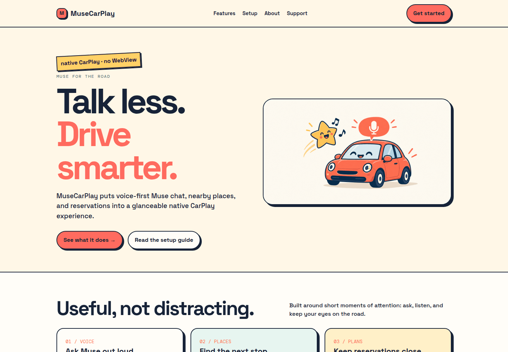
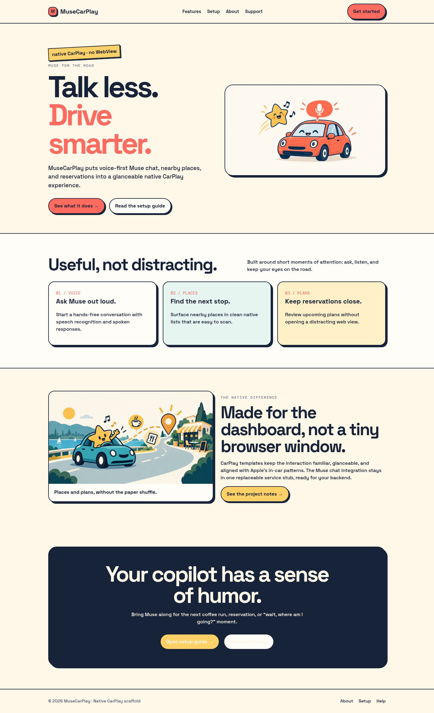
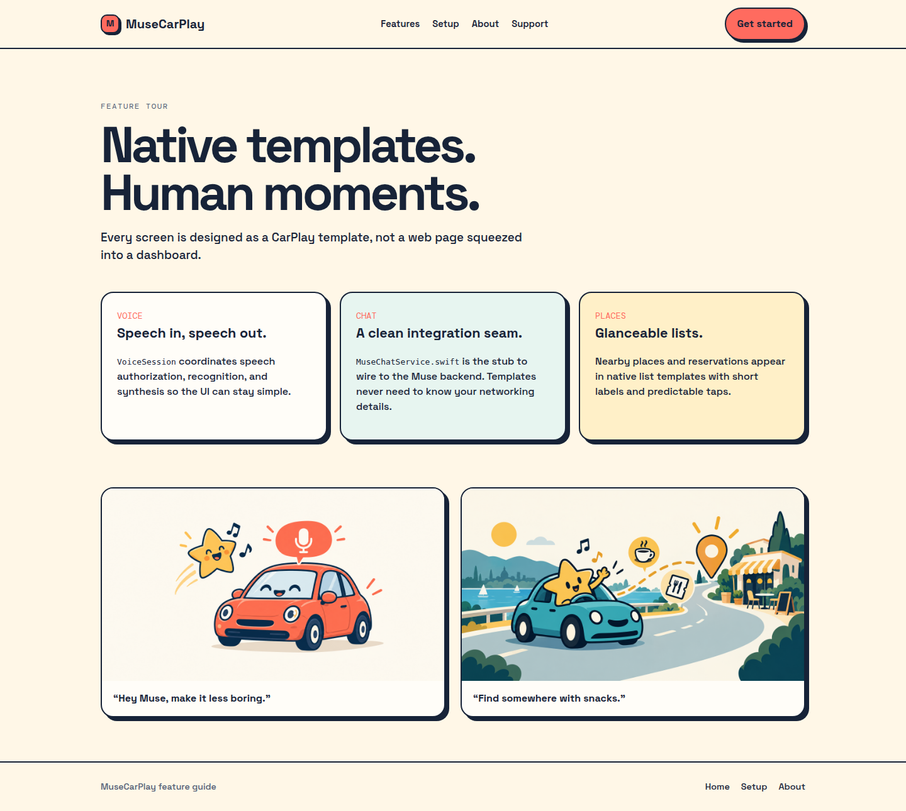
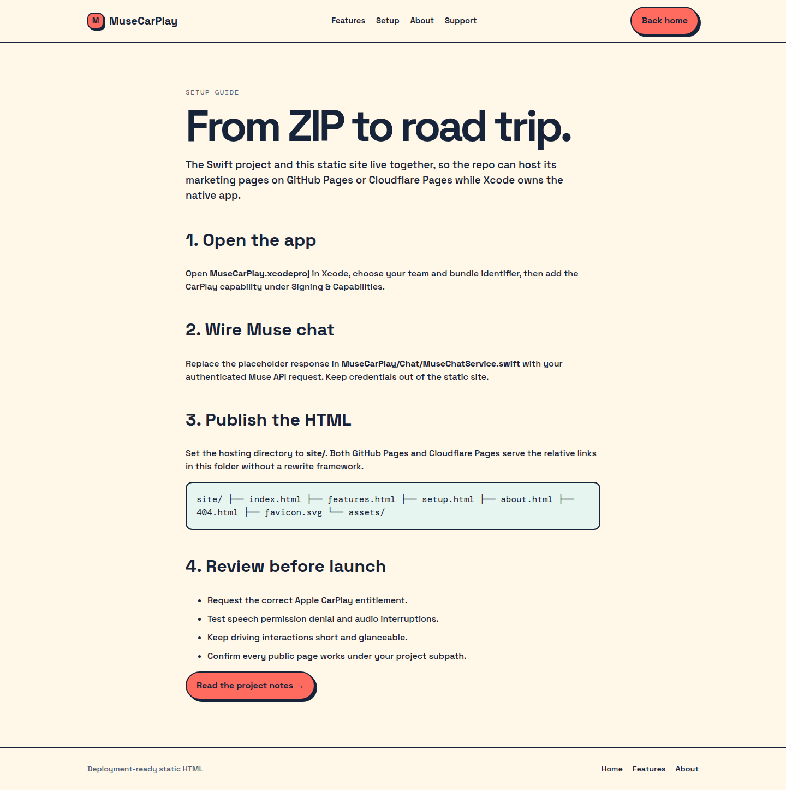

# MuseCarPlay

> A native CarPlay scaffold for voice-first Muse conversations, nearby places, and reservations—plus a static landing site you can run in seconds.

[](LICENSE)

## Why this exists

CarPlay is not a tiny browser window. A web page squeezed into the dashboard makes voice interaction, glanceable lists, permissions, and driving-safe behavior harder to reason about.

MuseCarPlay separates those concerns into native CarPlay templates, voice services, chat and places stubs, and a small static site for explaining the project. The intended flow is simple: ask Muse out loud, hear a response, find a nearby place, or review a reservation without turning the dashboard into a WebView.

The repository is currently a **starter scaffold**, not a finished production app. The static site is runnable today. The Swift source shows the intended native architecture, but the checked-in `MuseCarPlay.xcodeproj/project.pbxproj` is still a minimal placeholder and has not been verified as a buildable Xcode target in this Linux environment. You will need to wire the target in Xcode, add your Apple-approved CarPlay entitlement, and replace the service stubs before shipping.

## See it work

**Fastest verified demo:** run the static site locally.

```bash
python3 -m http.server 8765 --directory site
```

Then open <http://127.0.0.1:8765/>. The landing page links to the real feature, setup, project-notes, support, and 404 pages. No package manager or build step is required for this demo.

A short recording made from those actual pages:



The static site entry point is [`site/index.html`](site/index.html). Its fastest useful pages are:

- [`site/features.html`](site/features.html) — what the native layers are meant to do.
- [`site/setup.html`](site/setup.html) — Xcode, entitlement, and deployment notes.
- [`site/about.html`](site/about.html) — the project map and current scope.
- [`site/payments.html`](site/payments.html) — the age-gated support/payment page.

There is **no live demo URL in this repository yet**. A GitHub Pages workflow is included below, but it will not publish until this repository is pushed to GitHub and Pages is enabled for the repository.

## Screenshots

These are captured from the locally served HTML site, not mockups:

| Landing page | Feature tour |
| --- | --- |
|  |  |



## Quick start

### Static site: quickest path

```bash
# install: no package installation required; Python 3 is enough

# run
python3 -m http.server 8765 --directory site

# open
# http://127.0.0.1:8765/
```

There is no checked-in automated HTML test command yet. For a smoke test, open the site and click through `Features`, `Setup`, `About`, `Support`, and the footer `Help` link. The repository's local page and redirect targets are all HTML files.

### Native iOS / CarPlay scaffold

The native source is organized for Xcode:

```text
MuseCarPlay/
├── App/          app entry point, Info.plist, entitlements
├── Scenes/       CarPlay scene delegate
├── CarPlay/      native CPTemplate screens
├── Voice/        speech recognition, synthesis, and session state
├── Chat/         Muse chat model and integration seam
├── Places/       nearby places and reservation stubs
├── Models/       Place and Reservation values
└── Views/        minimal SwiftUI companion views
```

Open [`MuseCarPlay.xcodeproj`](MuseCarPlay.xcodeproj) in Xcode, then expect to do the following before a native build is possible:

1. Set the team and bundle identifier.
2. Add the source files, test files, build phases, and build configurations to the target; the checked-in project file is intentionally minimal.
3. Request and configure the Apple CarPlay entitlement described in [`docs/CARPLAY-SETUP.md`](docs/CARPLAY-SETUP.md).
4. Replace the placeholder behavior in [`MuseChatService.swift`](MuseCarPlay/Chat/MuseChatService.swift) and [`PlacesService.swift`](MuseCarPlay/Places/PlacesService.swift).
5. Run the XCTest files from Xcode on a Mac with the required Apple SDKs.

## The important integration seam

[`MuseChatService.swift`](MuseCarPlay/Chat/MuseChatService.swift) is deliberately small. It currently returns a placeholder assistant message; it does not call a live Muse backend. Add authentication, request construction, decoding, error handling, and connectivity behavior there rather than inside CarPlay templates.

The same principle applies to the places layer: `PlacesService` returns sample data and `ReservationService` returns an empty list until connected to a real provider.

## GitHub Pages and Cloudflare Pages

The static site is already laid out as a deployable directory:

```text
site/
├── index.html
├── features.html
├── setup.html
├── about.html
├── payments.html
├── 404.html
├── favicon.svg
├── _headers
├── _redirects
└── assets/
```

- **GitHub Pages:** `.github/workflows/pages.yml` publishes the `site/` directory after the repository is pushed and Pages is configured to use GitHub Actions.
- **Cloudflare Pages:** set the project’s output directory to `site/`. The checked-in `_headers` and `_redirects` files are ready for Cloudflare Pages.
- **Live status:** no public deployment has been verified from this checkout.

## Safety and production checklist

- CarPlay UI should remain glanceable and voice-led; do not require free-form typing while driving.
- Apple entitlement approval and a correctly provisioned bundle are required for production CarPlay distribution.
- Test speech authorization denial, audio interruptions, disconnection, and network failure.
- Do not put API keys or payment secrets in the static site.
- The support/payment page is a client-side eligibility gate, not legally sufficient identity or age verification where regulated age verification is required.

## License

MuseCarPlay is released under the [MIT License](LICENSE).

## Referral codes

Check out Muse, your personal AI agent. Redeem my code in Settings within 48 hours of joining and we'll both get 1 billion Muse tokens.

**Code:** `5F2V31`  
<https://muse.ai/join>

**Manus AI invite code:** `G3ADN`

Join me on Teamily, the human-agent platform, where you and always-on agents get work done together in one unified and context-aware space.

Redeem my code in Settings → Credits Center and you'll get 5 CREDITS right away.

**Code:** `2U6Q8D`  
<https://teamily.ai/i/2U6Q8D>

### Second Muse account

Check out Muse, your personal AI agent. Redeem my code in Settings within 48 hours of joining and we'll both get 1 billion Muse tokens.

**Code:** `0A0K7R`  
<https://muse.ai/join>
